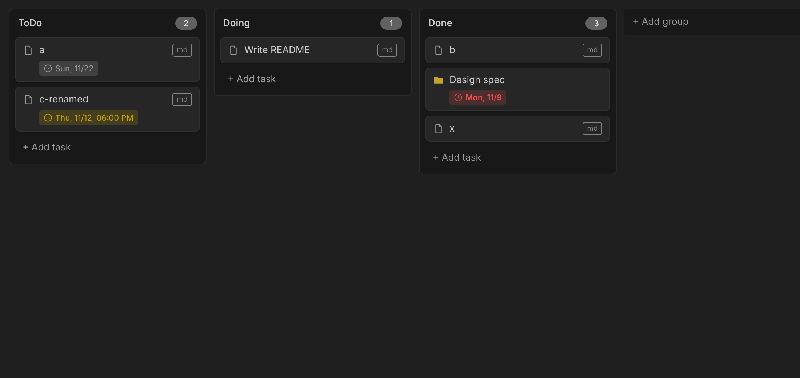

# Folder Kanban

プロジェクト内のフォルダーとファイルを、Trello のようなカンバンボードとして表示・操作する VS Code 拡張機能です。



## 仕組み

```
project/                  ← ボードのルート
├── .folder-kanban.json   ← ボード設定 (グループ・並び順)
├── ToDo/                 ← タスクグループ
│   ├── ドキュメント作成.md ← タスク (ファイル)
│   └── 大きな機能/        ← タスク (フォルダー)
├── Doing/
└── Done/
```

- **タスクグループ**: ルート直下のフォルダー。`.folder-kanban.json` に登録したものだけが表示されます。
- **タスク**: 各タスクグループフォルダー直下のファイルまたはフォルダー。
- `.folder-kanban.json` にグループの並び順と、グループ内のタスクの並び順を保存します。設定に載っていないファイル (エクスプローラーで追加したものなど) はグループの末尾に表示されます。
- `.` で始まる名前は常に非表示です。その他は設定 `folderKanban.exclude` で除外できます。

```json
{
  "groups": [
    { "folder": "ToDo",  "tasks": ["ドキュメント作成.md", "大きな機能"] },
    { "folder": "Doing", "tasks": [] },
    { "folder": "Done",  "tasks": [] }
  ]
}
```

## 使い方

| 操作 | 方法 |
| --- | --- |
| ボードを開く | コマンドパレット **Folder Kanban: ボードを開く**、またはエクスプローラーでフォルダーを右クリック → **ボードを開く** |
| タスクグループの追加 | ボード右端の **+ グループを追加** (既存フォルダーを選択、または新規作成) |
| タスクグループの並べ替え | グループのヘッダーをドラッグ |
| タスクの追加 | グループ下部の **+ タスクを追加**。拡張子を省略すると `.md`、末尾を `/` にするとフォルダーを作成 |
| タスクの並べ替え・移動 | カードをドラッグ。別グループへ移動すると実ファイル/フォルダーも移動します |
| タスクを開く | カードをクリック (ファイルはエディターで開き、フォルダーはエクスプローラーで表示) |
| タスク名の変更・削除 | カードを右クリック |
| グループのフォルダー名変更・ボードから外す | グループのヘッダーを右クリック (ボードから外してもフォルダーは削除されません) |

エクスプローラーなどでファイルを変更すると、ボードも自動で更新されます。

## 設定

| 設定 | 既定値 | 説明 |
| --- | --- | --- |
| `folderKanban.boardRoot` | `""` | **ボードを開く** で使うルート (ワークスペースフォルダーからの相対パス。空ならワークスペースフォルダー自体) |
| `folderKanban.newTaskExtension` | `".md"` | 拡張子なしで作成したタスクに付ける拡張子 |
| `folderKanban.exclude` | `["node_modules"]` | グループ・タスクとして表示しない名前 |

## インストール

1. リポジトリの **Releases** から `folder-kanban-x.y.z.vsix` をダウンロードします。
2. VS Code の拡張機能ビューの `...` メニュー → **VSIX からのインストール...** で選択するか、次のコマンドを実行します。

   ```bash
   code --install-extension folder-kanban-x.y.z.vsix
   ```

## 開発

```bash
npm ci
npm run build       # dist/ に拡張機能と webview をビルド (npm run watch で監視)
npm run typecheck
npm test            # ボードモデルの単体テスト
npm run e2e         # vscode API のモック + Chromium で webview の D&D とファイル移動を確認 (Playwright が必要)
npm run package     # dist-vsix/ に .vsix を作成
```

VS Code でこのフォルダーを開いて F5 を押すと、拡張機能を読み込んだ開発用ウィンドウが起動します。

### リリース手順

1. `package.json` の `version` を更新してコミット・push (例: `0.2.0`)
2. 次のどちらかでリリースを作成
   - GitHub の **Actions** タブ → **Release** → **Run workflow** (タグ `v0.2.0` は自動で作成されます)
   - またはバージョンと同じタグを push: `git tag v0.2.0 && git push origin v0.2.0`
3. GitHub Actions (`.github/workflows/release.yml`) がビルドし、Release に `.vsix` を添付します。`v0.2.0-beta.1` のように `-` を含むバージョンはプレリリースになります。
